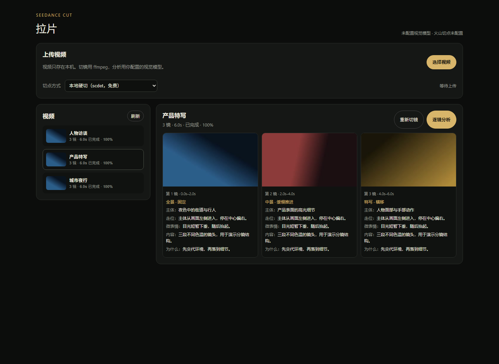
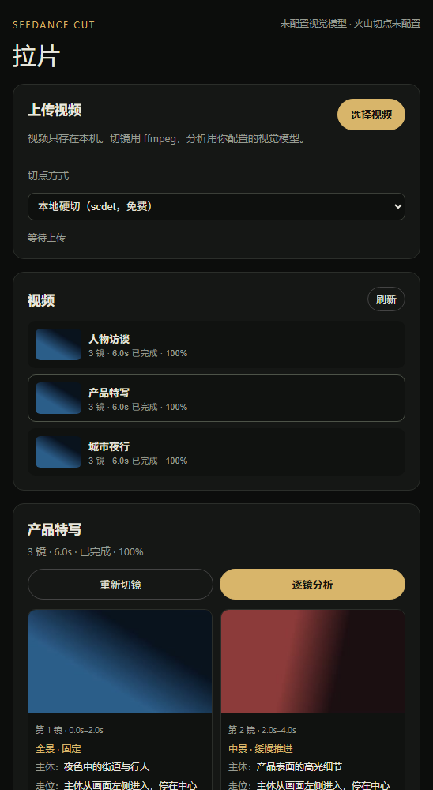

# Seedance Cut


A local, single-user shot splitter and shot analyser for short video.

Upload a clip, cut it into shots, then analyse each shot with any
OpenAI-compatible vision model you configure. No account system, no cloud
database, no uploads to a third-party video service.

> 涓枃锛氭妸瑙嗛涓婁紶鍒版湰鏈猴紝鐢?ffmpeg 鍒囬暅锛屽啀鐢ㄤ綘鑷繁鐨勮瑙夋ā鍨嬮€愰暅鍒嗘瀽銆?> 娌℃湁璐﹀彿銆佹病鏈変簯绔綔鍝佸簱锛岃棰戦粯璁ゅ彧鐣欏湪杩欏彴鐢佃剳銆?


*涓荤晫闈細宸﹁竟鏄棰戝垪琛紝鍙宠竟鏄綋鍓嶈棰戠殑鍒嗛暅銆佺缉鐣ュ浘鍜岄€愰暅鍒嗘瀽缁撴灉銆傛埅鍥句负婕旂ず瑙嗛锛屼笉鏄湡瀹為」鐩礌鏉愩€?

## 涓夋宸ヤ綔娴?
```text
1. 涓婁紶瑙嗛      娴忚鍣ㄦ妸鏂囦欢鍙戠粰鏈満鏈嶅姟锛岃棰戜笉缁忚繃绗笁鏂圭綉鐩?2. 鑷姩鍒囬暅      ffmpeg 鎵剧‖鍒囷紝鐢熸垚姣忛暅缂╃暐鍥惧拰鍙挱鏀剧墖娈?3. 閫愰暅鍒嗘瀽      姣忛暅鍙?5 甯т氦缁欎綘鐨勮瑙夋ā鍨嬶紝缁撴灉鍐欏洖鏈湴 SQLite
```

鍒囬暅涓嶉渶瑕佹ā鍨嬶紝涔熶笉闇€瑕佽仈缃戙€傚彧鏈夆€滈€愰暅鍒嗘瀽鈥濅細璋冪敤浣犻厤缃殑瑙嗚鎺ュ彛銆?
## 鐣岄潰鎬庝箞璇?
| 鍖哄煙 | 浣滅敤 |
| --- | --- |
| 涓婁紶瑙嗛 | 閫夋嫨鏈湴瑙嗛锛涗笂浼犲悗鑷姩寮€濮嬪垏闀?|
| 鍒囩偣鏂瑰紡 | `涓ユ牸纭垏` / `鍖呭惈杞満` / `鏈湴妯″瀷鍥為€€`锛岄兘鍙敤鍏嶈垂鏈湴妯″紡 |
| 瑙嗛鍒楄〃 | 鎵€鏈夊凡涓婁紶瑙嗛銆侀暅澶存暟銆佹椂闀裤€佸垎鏋愮姸鎬?|
| 閲嶆柊鍒囬暅 | 鐢ㄦ柊鐨勫垏鐐规柟寮忛噸璺戝綋鍓嶈棰戯紝鏃у垎鏋愪細娓呯┖ |
| 閫愰暅鍒嗘瀽 | 閫愰暅璋冪敤瑙嗚妯″瀷锛屾樉绀鸿繘搴︼紱娌℃湁閰嶇疆妯″瀷鏃朵細鏄庣‘鎻愮ず |
| 鍒嗛暅鍗＄墖 | 姣忛暅鐨勭缉鐣ュ浘銆佽捣姝㈡椂闂淬€佹櫙鍒€佽繍闀溿€佷富浣撱€佽蛋浣嶃€佸井琛ㄦ儏銆佸唴瀹广€佷负浠€涔?|



*绐勫睆浼氳嚜鍔ㄥ彉鎴愬崟鍒楋紝涓婁紶銆佽棰戝垪琛ㄥ拰鍒嗛暅浠嶇劧鍙敤銆?

## 鍒嗘瀽缁撴灉閲屾湁浠€涔?
姣忎竴闀滀繚瀛樹互涓嬪瓧娈碉紝鏂逛究缁х画鍋氭媺鐗囩瑪璁般€佸壀杈戝垽鏂垨鎻愮ず璇嶅弽鎺細

| 瀛楁 | 鍚箟 |
| --- | --- |
| `size` | 鏅埆锛氳繙鏅?/ 鍏ㄦ櫙 / 涓櫙 / 杩戞櫙 / 鐗瑰啓 |
| `move` | 杩愰暅锛氬浐瀹氥€佹帹銆佹媺銆佹憞銆佺Щ銆佽窡銆佸崌闄嶇瓑 |
| `subject` | 鐢婚潰涓讳綋 |
| `blocking` | 涓讳綋璧颁綅涓庣敾闈綅缃彉鍖?|
| `micro_expression` | 琛ㄦ儏銆佺溂绁炪€佹墜閮ㄧ瓑缁嗚妭 |
| `content` | 杩欎竴闀滃彂鐢熶簡浠€涔?|
| `why` / `why_note` | 涓轰粈涔堣繖鏍峰垏銆佽繖鏍疯皟搴?|
| `rhythm` | 闀滃ご闀垮害涓庤妭濂忓垽鏂?|
| `confidence` | 妯″瀷瀵硅繖娆″垽鏂殑缃俊搴?|

## 閫傚悎璋?
- 瀵兼紨 / 鍓緫甯堬細鎶婂弬鑰冪墖鎷嗘垚鍙绱㈢殑闀滃ご琛ㄣ€?- 鍒嗛暅甯堬細鏁寸悊鏅埆銆佽繍闀溿€佽蛋浣嶏紝鍋氳嚜宸辩殑闀滃ご搴撱€?- AIGC 鍒涗綔鑰咃細鎶婂疄鎷嶅弬鑰冩媶鎴愰€愰暅鎻忚堪锛屽啀鏀瑰啓鎴愮敓鎴愭彁绀鸿瘝銆?- 褰辫瀛︾敓锛氬仛鎷夌墖浣滀笟锛屼繚鐣欐瘡闀滄埅鍥惧拰鏃堕棿鐮併€?
## 涓嶉€傚悎浠€涔?
- 涓嶆槸鈥滀竴閿ā浠跨垎娆锯€濈殑鎴愮墖鐢熸垚鍣ㄣ€?- 涓嶆浛浠ｄ汉宸ュ垽鏂紝妯″瀷杈撳嚭浠嶈澶嶆牳銆?- 涓嶉€傚悎鐩存帴鏆撮湶鍒板叕缃戝仛澶氱鎴锋湇鍔★紱杩欐槸鍗曠敤鎴锋湰鍦板伐鍏枫€?
## 鎺ㄨ崘妯″瀷缁勫悎

鏈湴 `scdet` 鍙€傚悎鍋氫繚搴曪細瀹冪湅鐨勬槸甯ч棿宸紓锛岄亣鍒伴棯鐧姐€佹墜鎸佹姈鍔ㄣ€佸彔鍖栦細璇垏锛屼篃涓嶇悊瑙ｂ€滃満鏅€濄€傚鏋滄兂瑕佸彲鐩存帴鐢ㄤ簬鎷夌墖鐨勭粨鏋滐紝寤鸿鎶?*鍒囬暅**鍜?*鍒嗘瀽**鍒嗗紑閫夛細

### 鍒囬暅锛氱伀灞变紭鍏堬紝鑵捐绗簩

| 鏂规 | 閫傜敤 | 鎴愭湰 | 鏈」鐩姸鎬?|
| --- | --- | --- | --- |
| 鐏北寮曟搸 AI MediaKit `semantic-segment-pro` | 鏅€氱煭瑙嗛銆佸箍鍛娿€佸墽鎯呯墖锛岃涔夊垏鐐规洿绋?| 鎸夐噺浠樿垂 | 宸插唴缃紝閫夋嫨鈥滅伀灞?MediaKit鈥濆嵆鍙?|
| 鑵捐浜?VOD + MPS 鏅鸿兘鎷嗘潯锛坄screen_strip`锛?| 闀胯棰戙€佹柊闂?璇剧▼銆侀渶瑕侀暅澶寸骇鎷嗘潯 | 鎸夐噺浠樿垂 | 鎺ㄨ崘澶囬€夛紱闇€瑕?VOD FileId锛屽綋鍓嶇増鏈湭鎶婃湰鍦版枃浠惰嚜鍔ㄤ笂浼犲埌鑵捐 |
| 鏈湴 ffmpeg `scdet` | 纭垏鏄庢樉銆佸畬鍏ㄧ绾裤€侀浂鎴愭湰 | 鍏嶈垂 | 榛樿淇濆簳 |

鐏北瀹樻柟浜у搧锛?https://www.volcengine.com/product/mediakit>  
鑵捐浜戞櫤鑳芥媶鏉℃枃妗ｏ細<https://cloud.tencent.com/document/product/862/112098>  
鑵捐瑕佹眰鍚屾椂寮€閫?VOD 鍜?MPS锛屽苟浣跨敤 27 鍙锋ā鏉?+ `{"strip":{"type":"screen_strip"}}`銆?
### 鍒嗘瀽锛氳嚦灏戝噯澶囦袱瀹惰瑙夋ā鍨?
| 鎺ㄨ崘 | 閫傚悎 | 閰嶇疆 |
| --- | --- | --- |
| 璞嗗寘 / 鐏北鏂硅垷 | 涓枃鐢婚潰缁嗚妭銆佷汉鐗╁拰鏈嶅寲閬撴弿杩?| `SEEDANCE_MODEL_PROVIDER=doubao` |
| DeepSeek锛堣瑙夋ā鍨嬶級 | 鎬т环姣斻€佺粨鏋勫寲瀛楁绋冲畾 | `SEEDANCE_MODEL_PROVIDER=deepseek` |
| Kimi / Moonshot | 闀夸笂涓嬫枃銆侀暱鐗囬€愰暅鎬荤粨 | `SEEDANCE_MODEL_PROVIDER=kimi` |
| 浠绘剰 OpenAI 鍏煎鎺ュ彛 | 鑷缓 vLLM銆丩M Studio銆佸叾浠栦簯 | `SEEDANCE_MODEL_PROVIDER=custom` + Base URL |

宸ュ叿涓嶇粦瀹氭煇涓€瀹舵ā鍨嬶紱**寤鸿鑷冲皯閰嶇疆涓ゅ**锛屼竴瀹朵富鐢紝鍙︿竴瀹剁敤鏉ュ鏍稿悓涓€鎵归暅澶淬€傚垏鎹㈠彧闇€鏀?`.env` 鐨?`SEEDANCE_MODEL_PROVIDER` 鍜?`SEEDANCE_MODEL`锛屼笉闇€瑕佹敼浠ｇ爜銆?
> 娉ㄦ剰锛氶€夋嫨鐏北鍒囬暅浼氭妸瑙嗛涓婁紶鍒扮伀灞憋紱閫夋嫨浜戠鍒嗘瀽浼氭妸鍏抽敭甯у彂缁欎綘閰嶇疆鐨勬ā鍨嬫湇鍔°€傚畬鍏ㄧ绾挎椂鍙敤鏈湴 `scdet`锛屼笉璋冪敤浠讳綍浜戞湇鍔°€?
## Requirements

- Python 3.11+
- ffmpeg 5.1+ available on `PATH`
- A vision-capable OpenAI-compatible endpoint (optional; cutting works without it)

## Run

```bash
cp .env.example .env
# edit .env if you want analysis
python app.py
```

Open <http://127.0.0.1:8765>.

Data is written to `./data`:

```text
data/
  studio.db
  uploads/
  media/<media-id>/thumbs/
  media/<media-id>/clips/
```

Set `SEEDANCE_DATA_DIR` to move it.

## Configure a vision model

Any endpoint that accepts `POST /chat/completions` with image content works:
Doubao/ARK, DeepSeek-compatible gateways, Kimi, a local vLLM or LM Studio.
Pick a provider name so the base URL is filled automatically:

```dotenv
# doubao | deepseek | kimi | custom
SEEDANCE_MODEL_PROVIDER=doubao
SEEDANCE_MODEL=your-vision-model
SEEDANCE_API_KEY=sk-...
```

Preset base URLs:

| Provider | Base URL |
| --- | --- |
| `doubao` | `https://ark.cn-beijing.volces.com/api/v3` |
| `deepseek` | `https://api.deepseek.com/v1` |
| `kimi` | `https://api.moonshot.cn/v1` |
| `custom` | your `SEEDANCE_MODEL_BASE_URL` |

The model ID must be one enabled in that provider's console; model names change,
so the app deliberately does not hardcode a model ID. The same `.env` can be
switched between providers without code changes.

The server never sends the key to the browser. If it is missing, cutting still
works and the analyse button explains what is missing.

## Cut modes

| Mode | Meaning | Cost |
| --- | --- | --- |
| `local:cuts` | strict hard cuts via ffmpeg `scdet` | free |
| `local:all` | also treat sustained scene-score runs as transitions | free |
| `local:model` | try the optional local TransNetV2 environment, fall back to `scdet` | free |
| `volcengine` | volcano MediaKit `semantic-segment-pro` cloud shot cut | paid |
| `tencent` (planned) | Tencent VOD/MPS `screen_strip`, requires a VOD FileId | paid |

The local model is optional and is not included. The app works without it.
For a production-grade cut, use Volcengine; for a second opinion on long
videos, Tencent MPS is the recommended alternative.

## API

```text
GET  /api/health
GET  /api/media
GET  /api/media/:id
POST /api/media/upload       raw body + X-Filename header
POST /api/media/:id/cut      {"mode":"cuts"|"all"|"model"}
POST /api/media/:id/analyze
GET  /media/:id/<relative-path>
```

## Tests

```bash
python -m unittest discover -s tests -v
```

The tests generate a local test-pattern video, cut it with ffmpeg, and do not
call any external API.

## Docker

```bash
docker compose up --build
```

Then open <http://127.0.0.1:8765>. Put your model settings in `.env`; the
`data/` directory is mounted as a volume.

## Security notes

- The server binds to `127.0.0.1` by default. Do not expose it publicly without
  adding authentication and upload limits.
- Upload size is capped by `SEEDANCE_MAX_UPLOAD_MB` (default 4096).
- Only whitelisted video extensions are accepted.
- Keys live in `.env` or the process environment, never in the repository.

## License

Apache-2.0 for this repository's code. ffmpeg is a separate program with its
own license; model weights and third-party assets are not bundled. See
`THIRD_PARTY.md` and `NOTICE`.

## Status

Early `0.1.1`. The UI is intentionally small; the analysis schema is stable
enough to build on, but expect changes before `1.0`.

