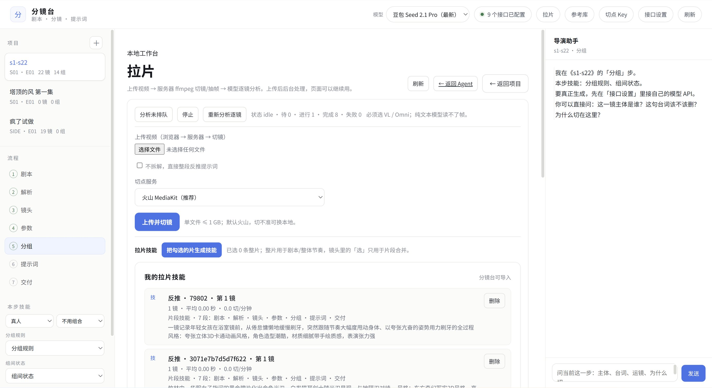
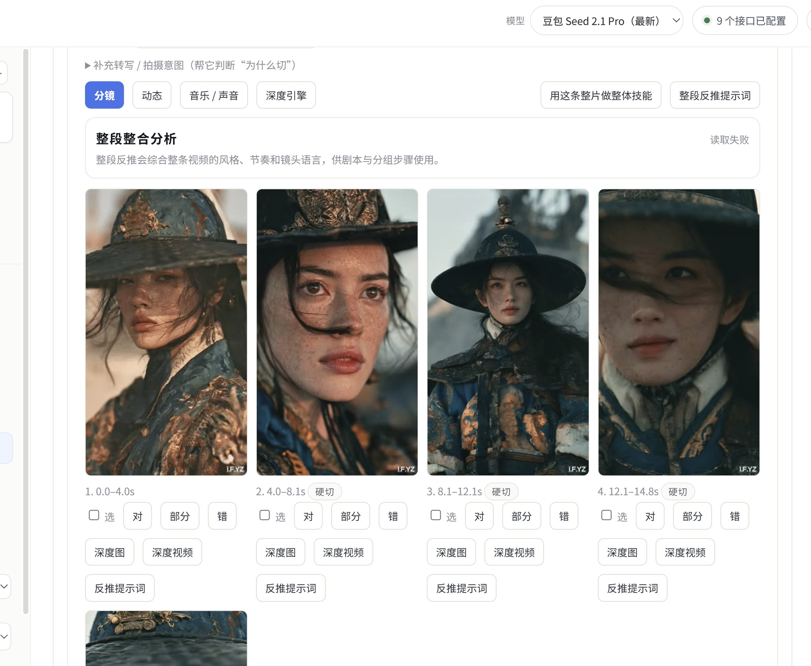
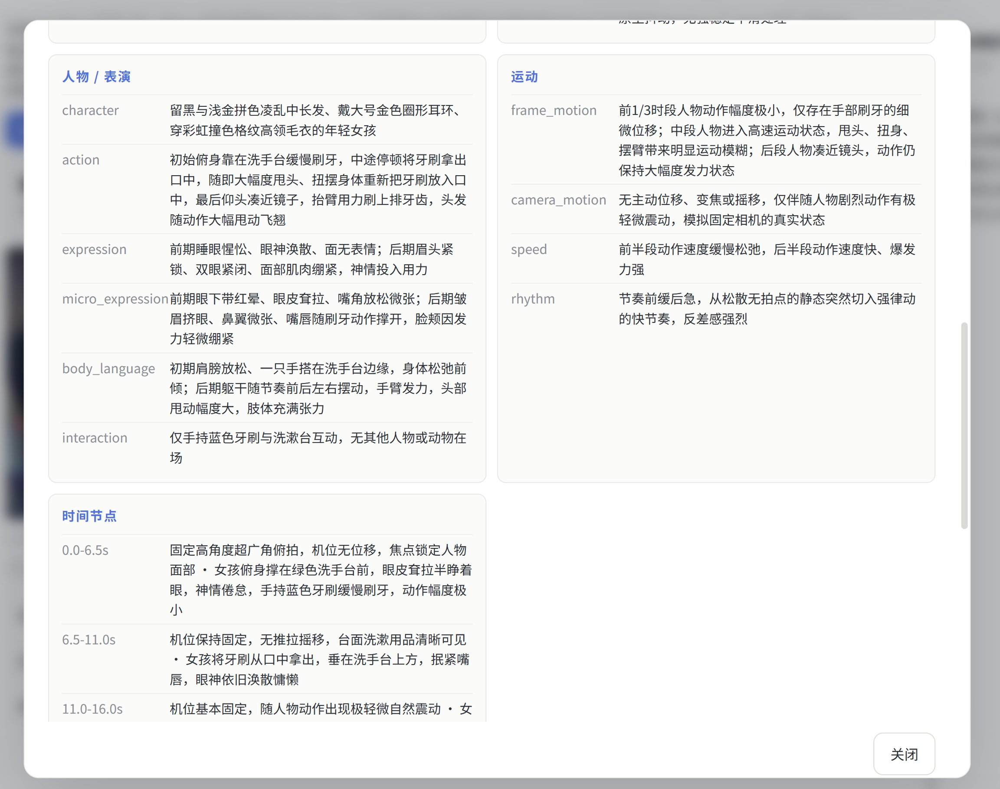

# 导演分镜精准拉片工作台


A local, single-user shot splitter and shot analyser for short video.

Upload a clip, cut it into shots, then analyse each shot with any
OpenAI-compatible vision model you configure. No account system, no cloud
database, no uploads to a third-party video service.

> 中文：把视频上传到本机，用 ffmpeg 切镜，再用你自己的视觉模型逐镜分析。
> 没有账号、没有云端作品库，视频默认只留在这台电脑。


*主界面：左边是视频列表，右边是当前视频的分镜、缩略图和逐镜分析结果。截图为演示视频，不是真实项目素材。*

## 三步工作流

```text
1. 上传视频      浏览器把文件发给本机服务，视频不经过第三方网盘
2. 自动切镜      ffmpeg 找硬切，生成每镜缩略图和可播放片段
3. 逐镜分析      每镜取 5 帧交给你的视觉模型，结果写回本地 SQLite
```

切镜不需要模型，也不需要联网。只有“逐镜分析”会调用你配置的视觉接口。

## 界面怎么读

| 区域 | 作用 |
| --- | --- |
| 上传视频 | 选择本地视频；上传后自动开始切镜 |
| 切点方式 | 本地硬切 / 含转场 / 本地模型回退 / 火山 MediaKit（云端付费） |
| 视频列表 | 所有已上传视频、镜头数、时长、分析状态 |
| 重新切镜 | 用新的切点方式重跑当前视频，旧分析会清空 |
| 逐镜分析 | 逐镜调用视觉模型，显示进度；没有配置模型时会明确提示 |
| 分镜卡片 | 每镜的缩略图、起止时间、景别、运镜、主体、走位、微表情、内容、为什么 |


*窄屏会自动变成单列，上传、视频列表和分镜仍然可用。*

## 实际工作台案例

### 主工作台：切点、技能、分组



这是实际分镜台界面：顶部选视觉模型和切点服务，左侧是项目与步骤，中间上传视频并选择“火山 MediaKit”，右侧是导演助手。截图里能看到“拉片技能”和七段流程，不是概念图。

### 整段分析 + 分镜卡片



整段反推会把风格、节奏和镜头语言合在一起；下面逐镜显示时间码、硬切标记、选片/对错复核、深度图和反推提示词入口。

> 这张截图里“整段整合分析”显示了“读取失败”。这是实际运行时的一次失败状态，我没有把它裁掉或说成成功；分镜列表和单镜结果仍然保留。README 不承诺每次云端调用都成功，失败会明确显示。

### 单镜详情：人物、表演、运动、时间节点



单镜详情把 `character`、`action`、`expression`、`micro_expression`、`body_language`、`camera_motion`、`speed`、`rhythm` 和时间节点分开写，方便直接做拉片笔记或改写成生成提示词。

## 分析结果里有什么

每一镜保存以下字段，方便继续做拉片笔记、剪辑判断或提示词反推：

| 字段 | 含义 |
| --- | --- |
| `size` | 景别：远景 / 全景 / 中景 / 近景 / 特写 |
| `move` | 运镜：固定、推、拉、摇、移、跟、升降等 |
| `subject` | 画面主体 |
| `blocking` | 主体走位与画面位置变化 |
| `micro_expression` | 表情、眼神、手部等细节 |
| `content` | 这一镜发生了什么 |
| `why` / `why_note` | 为什么这样切、这样调度 |
| `rhythm` | 镜头长度与节奏判断 |
| `confidence` | 模型对这次判断的置信度 |

## 适合谁

- 导演 / 剪辑师：把参考片拆成可检索的镜头表。
- 分镜师：整理景别、运镜、走位，做自己的镜头库。
- AIGC 创作者：把实拍参考拆成逐镜描述，再改写成生成提示词。
- 影视学生：做拉片作业，保留每镜截图和时间码。

## 不适合什么

- 不是“一键模仿爆款”的成片生成器。
- 不替代人工判断，模型输出仍要复核。
- 不适合直接暴露到公网做多租户服务；这是单用户本地工具。

## 推荐模型组合

本地 `scdet` 只适合做保底：它看的是帧间差异，遇到闪白、手持抖动、叠化会误切，也不理解“场景”。本地 TransNetV2 不是默认安装项，普通电脑上的效果也不稳定。所以真正用于拉片时，**优先用云切点**。

### 切镜：火山优先，腾讯第二

| 方案 | 适用 | 成本 | 本项目状态 |
| --- | --- | --- | --- |
| 火山引擎 AI MediaKit `semantic-segment-pro` | 普通短视频、广告、剧情片，语义切点更稳 | 按量付费 | 已内置，选择“火山 MediaKit”即可 |
| 腾讯云 VOD + MPS 智能拆条（`screen_strip`） | 长视频、新闻/课程、需要镜头级拆条 | 按量付费 | 推荐备选；需要 VOD FileId，当前版本未把本地文件自动上传到腾讯 |
| 本地 ffmpeg `scdet` | 硬切明显、完全离线、零成本 | 免费 | 默认保底 |

火山官方产品：<https://www.volcengine.com/product/mediakit>  
腾讯云智能拆条文档：<https://cloud.tencent.com/document/product/862/112098>  
腾讯要求同时开通 VOD 和 MPS，并使用 27 号模板 + `{"strip":{"type":"screen_strip"}}`。

### 分析：至少准备两家视觉模型

| 推荐 | 适合 | 配置 |
| --- | --- | --- |
| 豆包 / 火山方舟 | 中文画面细节、人物和服化道描述 | `SEEDANCE_MODEL_PROVIDER=doubao` |
| DeepSeek（视觉模型） | 性价比、结构化字段稳定 | `SEEDANCE_MODEL_PROVIDER=deepseek` |
| Kimi / Moonshot | 长上下文、长片逐镜总结 | `SEEDANCE_MODEL_PROVIDER=kimi` |
| 任意 OpenAI 兼容接口 | 自建 vLLM、LM Studio、其他云 | `SEEDANCE_MODEL_PROVIDER=custom` + Base URL |

工具不绑定某一家模型；**建议至少配置两家**，一家主用，另一家用来复核同一批镜头。切换只需改 `.env` 的 `SEEDANCE_MODEL_PROVIDER` 和 `SEEDANCE_MODEL`，不需要改代码。

> 注意：选择火山切镜会把视频上传到火山；选择云端分析会把关键帧发给你配置的模型服务。完全离线时只用本地 `scdet`，不调用任何云服务。

## Requirements

- Python 3.11+
- ffmpeg 5.1+ available on `PATH`
- A vision-capable OpenAI-compatible endpoint (optional; cutting works without it)

## Run

```bash
cp .env.example .env
# edit .env if you want analysis
python app.py
```

Open <http://127.0.0.1:8765>.

Data is written to `./data`:

```text
data/
  studio.db
  uploads/
  media/<media-id>/thumbs/
  media/<media-id>/clips/
```

Set `SEEDANCE_DATA_DIR` to move it.

## Configure a vision model

Any endpoint that accepts `POST /chat/completions` with image content works:
Doubao/ARK, DeepSeek-compatible gateways, Kimi, a local vLLM or LM Studio.
Pick a provider name so the base URL is filled automatically:

```dotenv
# doubao | deepseek | kimi | custom
SEEDANCE_MODEL_PROVIDER=doubao
SEEDANCE_MODEL=your-vision-model
SEEDANCE_API_KEY=sk-...
```

Preset base URLs:

| Provider | Base URL |
| --- | --- |
| `doubao` | `https://ark.cn-beijing.volces.com/api/v3` |
| `deepseek` | `https://api.deepseek.com/v1` |
| `kimi` | `https://api.moonshot.cn/v1` |
| `custom` | your `SEEDANCE_MODEL_BASE_URL` |

The model ID must be one enabled in that provider's console; model names change,
so the app deliberately does not hardcode a model ID. The same `.env` can be
switched between providers without code changes.

The server never sends the key to the browser. If it is missing, cutting still
works and the analyse button explains what is missing.

## Cut modes

| Mode | Meaning | Cost |
| --- | --- | --- |
| `local:cuts` | strict hard cuts via ffmpeg `scdet` | free |
| `local:all` | also treat sustained scene-score runs as transitions | free |
| `local:model` | try the optional local TransNetV2 environment, fall back to `scdet` | free |
| `volcengine` | volcano MediaKit `semantic-segment-pro` cloud shot cut | paid |
| `tencent` (planned) | Tencent VOD/MPS `screen_strip`, requires a VOD FileId | paid |

The local model is optional and is not included. The app works without it.
For a production-grade cut, use Volcengine; for a second opinion on long
videos, Tencent MPS is the recommended alternative.

## API

```text
GET  /api/health
GET  /api/media
GET  /api/media/:id
POST /api/media/upload       raw body + X-Filename header
POST /api/media/:id/cut      {"mode":"cuts"|"all"|"model"}
POST /api/media/:id/analyze
GET  /media/:id/<relative-path>
```

## Tests

```bash
python -m unittest discover -s tests -v
```

The tests generate a local test-pattern video, cut it with ffmpeg, and do not
call any external API.

## Docker

```bash
docker compose up --build
```

Then open <http://127.0.0.1:8765>. Put your model settings in `.env`; the
`data/` directory is mounted as a volume.

## Security notes

- The server binds to `127.0.0.1` by default. Do not expose it publicly without
  adding authentication and upload limits.
- Upload size is capped by `SEEDANCE_MAX_UPLOAD_MB` (default 4096).
- Only whitelisted video extensions are accepted.
- Keys live in `.env` or the process environment, never in the repository.

## License

Apache-2.0 for this repository's code. ffmpeg is a separate program with its
own license; model weights and third-party assets are not bundled. See
`THIRD_PARTY.md` and `NOTICE`.

## Status

Early `0.1.1`. The UI is intentionally small; the analysis schema is stable
enough to build on, but expect changes before `1.0`.
